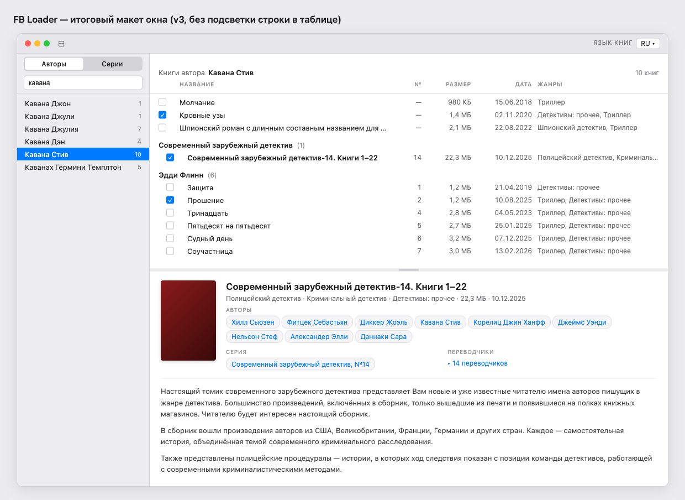

# UI Polish — Design Spec

**Date:** 2026-05-01
**Goal:** Polish текущего UI FB Loader с сохранением структуры (toolbar / sidebar / books / book card). Без структурных изменений — только визуальная согласованность, типографика, отступы, чёткие колонки таблицы и аккуратная карточка книги с прокручиваемой аннотацией.

**Reference mockup:** [`window.png`](assets/2026-05-01-ui-polish/window.png)



---

## Что мы НЕ меняем

- `NavigationSplitView` структура: sidebar (Авторы/Серии) → центральная панель → нижняя карточка (VSplit)
- Поведение фильтрации, сортировки, экспорта — без правок в этой работе
- Контекстное меню «Выгрузить отмеченные (N)» по правой кнопке мыши на строке книги — остаётся как сейчас. Никаких toolbar-кнопок «Выгрузить»

---

## 1. Toolbar окна

Минимальный. Слева — стандартный sidebar toggle (NavigationSplitView предоставляет автоматически). Справа — language picker.

| Элемент | Стиль |
|---|---|
| Sidebar toggle | системный (NavigationSplitView) |
| Language picker | label «Язык книг» (caption2, secondary), затем `Picker` со стилем `.menu` без своего label-text — вариант показывается как `RU ▾` в тонкой рамке |

Никаких кнопок выгрузки и счётчиков отмеченных в toolbar.

**Реализация:** `LanguageFilterPicker` переезжает из верха `BooksTableView` в toolbar главного окна через `.toolbar { ToolbarItem(placement: .primaryAction) }` или `.toolbarItemPlacement(.automatic)`. Сам компонент остаётся как есть (см. `BooksTableView.swift:141-168`), только обёртка вокруг `Picker` получает `HStack` с уменьшенной caption-меткой `Text("Язык книг").font(.caption2).foregroundStyle(.secondary)`.

---

## 2. Sidebar (`LeftSidebarView`)

Header высотой ~72pt, с одним padding-блоком 12pt со всех сторон, разделитель снизу `Divider()`.

```
┌─ sidebar header ────────────────┐
│  [ Авторы | Серии ]  ← seg      │
│  [ Фильтр              ]  ← txt │
└──── 1px Divider ────────────────┘
│  Кавана Джон             1      │
│  Кавана Джули            1      │
│  Кавана Стив (sel)      10  ← bg accent, fg .white
│  …
```

| Элемент | Спека |
|---|---|
| Padding header | 12pt со всех сторон, `VStack(spacing: 8)` между picker и filter |
| Picker `Авторы / Серии` | `.pickerStyle(.segmented)`, без label, на всю ширину |
| Filter input | `TextField("Фильтр", …)`, `.textFieldStyle(.roundedBorder)`, на всю ширину |
| Divider под header | стандартный `Divider()` |
| Список (LazyListTable) | без изменений по архитектуре (NSTableView wrapper) |
| Строка списка | имя слева, count справа `secondary` (системный Color.secondary) |
| Hover строки | системная подсветка — оставить как сейчас (NSTableView default) |
| Выбранная строка | `accentColor` фон во всю ширину, текст `.white`, count полупрозрачный белый |

**Что чинит:** «неконсистентные отступы у списка авторов и фильтра», «фильтр налезает на список». Сейчас в `LeftSidebarView.swift:9-34` `padding(8)` на picker и `padding(.horizontal, 8)` на TextField — разные. Унифицируем в `VStack(spacing: 8) { picker; filter }.padding(12)` плюс `Divider()` под этим блоком, дальше — список.

---

## 3. Books table (`BooksTableView`)

Заменяет существующий `List` с `DisclosureGroup` на структурированную табличную панель с фиксированными колонками. Серии всегда развёрнуты — никакого DisclosureGroup, никаких caret-треугольников. Книги без серии — сверху плоским списком, без группового заголовка.

### 3.1 Заголовочный блок (header), padding 10×16pt

Две строки в `VStack`:
1. **Breadcrumb-row:** `HStack { Text("Книги автора").foregroundStyle(.secondary); Text(authorName).bold(); Spacer(); Text("\(n) книг").font(.caption).foregroundStyle(.secondary) }`. Если выбрана серия — `Text("Серия")` + название.
2. **Cols-row:** заголовки колонок, `font(.system(size: 10, weight: .semibold)).textCase(.uppercase).foregroundStyle(.secondary)` — `Название · № · Размер · Дата · Жанры`.

Под header — `Divider()`.

### 3.2 Колонки (одна grid-сетка для header и rows)

| # | Имя | Ширина | Выравнивание | Контент |
|---|---|---|---|---|
| 1 | (чекбокс) | 28pt | center | `Toggle` без label |
| 2 | Название | flex | leading, ellipsis-tail | `Text(book.title)` |
| 3 | № | 50pt | trailing, tabular | `seriesNum` или `—` если нет серии |
| 4 | Размер | 80pt | trailing, tabular | `ByteCountFormatter` |
| 5 | Дата | 100pt | trailing, tabular | `dd.MM.yyyy` |
| 6 | Жанры | 220pt | leading, ellipsis-tail | через `, ` |

`tabular` = `.monospacedDigit()` на этих `Text`.

### 3.3 Строки

- Высота как сейчас (~22pt)
- Loose books (без серии) — идут сверху, без группового заголовка, indent отсутствует (padding-leading = 16pt в общей сетке)
- Группа серии: жирная подпись `Text(series.name).bold() + Text(" (\(items.count))").foregroundStyle(.secondary)`, padding 12pt сверху, 4pt снизу. **Без caret/DisclosureGroup**, всегда развёрнута
- Книги внутри группы — отступ слева 30pt (от levo header'а — выглядят «вложенными»)
- **Hover-подсветка строки:** мягкая (`background: black 3% opacity`) — обязательна
- **Выбранная строка:** **только title жирнее** (`fontWeight(.semibold)`), без цветной подсветки. Связь с карточкой ниже — через жирность, ярких пятен в таблице нет
- Чекбокс при `checked`: системный `accentColor` фон с белой галочкой (стандартный SwiftUI Toggle стиль работает)

### 3.4 Контекстное меню (без изменений)

```
Выгрузить отмеченные (N)
```

Активно если N > 0. Остаётся в `bookRow` как сейчас (см. `BooksTableView.swift:116-123`).

**Что чинит:** «Авторы выводимые как попало» (теперь в карточке, см. §4), таблица колонок выровнена с заголовками; группы серий не схлопываются (раздражающий клик ушёл); выделенная строка не кричит цветом.

---

## 4. Book card (`BookDetailView`)

Полный редизайн. Один белый pane без отдельной card-обёртки — карточка на белом фоне `card-pane` с padding 16/20pt. Обложка — отдельная колонка слева; справа в одном `ScrollView` идут meta-grid, `Divider()` и аннотация (строка не шире 680pt), так что при прокрутке аннотация получает всю высоту pane.

### 4.1 Header (часть до Divider)

```
┌── Cover (100×145pt, 4pt corner radius, тень) ──┐  ┌─ Meta grid (2 cols, 1fr 1fr) ─────────────────────────┐
│                                                 │  │  [meta-wide, span 2]                                  │
│   обложка                                       │  │   <Title 17pt 600>                                    │
│                                                 │  │   <жанры · размер · дата>  (12pt secondary)           │
│                                                 │  │  ────────────────────────────                         │
│                                                 │  │  [meta-wide, span 2]                                  │
│                                                 │  │   АВТОРЫ                                              │
│                                                 │  │   [chip] [chip] [chip] …                              │
│                                                 │  │  ────────────────────────────                         │
│                                                 │  │  [col 1]            [col 2]                           │
│                                                 │  │  СЕРИЯ              ПЕРЕВОДЧИКИ                       │
│                                                 │  │  [chip Серия №14]   ▸ 14 переводчиков                 │
└─────────────────────────────────────────────────┘  └────────────────────────────────────────────────────────┘
```

| Элемент | Стиль |
|---|---|
| Cover | 100×145pt, `cornerRadius: 4`, `shadow: 0 2 6 black 15%` |
| Title | `.font(.system(size: 17, weight: .semibold))`, `lineLimit(nil)` |
| Meta inline (под title) | `.font(.system(size: 12)).foregroundStyle(.secondary)` — `жанры · размер · дата` через ` · ` |
| Lbl | `.font(.system(size: 10, weight: .semibold)).textCase(.uppercase).foregroundStyle(.secondary)`, letter-spacing 0.06em (`.kerning(0.6)` на 10pt — близко) |
| Chip | inline-block `padding 1×9pt`, background `Color(white: 0.96)`, border 1pt `Color(white: 0.88)`, cornerRadius 10pt, fg `accentColor`, font 12pt. Hover: invert (bg accent, fg .white) |
| Chip кликабельный | вся chip — Button(...).buttonStyle(.plain) с onTap |
| Translators toggle | `▸ N переводчиков`, `accentColor`, font 12pt, plain-button. По клику — раскрывается строка с именами через `, ` под header'ом (или сворачивается обратно) |
| Divider под header | стандартный `Divider()`, отступ 12pt снизу |

**Кликабельность chips:**

| Chip | Действие |
|---|---|
| Author chip | `state.sidebarTab = .authors; state.selectedAuthorID = author.id; state.selectedSeriesID = nil` |
| Series chip | `state.sidebarTab = .series; state.selectedSeriesID = series.id; state.selectedAuthorID = nil` |

(Логика уже есть в `BookDetailView.swift:21-41`, переиспользуем.)

### 4.2 Annotation (часть после Divider)

`ScrollView { Text(info.annotation).font(.body).foregroundStyle(Color(white: 0.23)) }`.

- Растянута: `frame(maxWidth: .infinity, maxHeight: .infinity)` под header'ом — занимает всё оставшееся пространство card-pane
- Lineheight ~1.55
- `padding(.trailing, 6)` под скроллбар, чтобы текст не упирался
- ScrollView имеет `.scrollIndicators(.automatic)` — macOS overlay-стиль; цвет thumb системный, без кастомного фона/блока

### 4.3 Authors overflow

В этой работе **специально не делаем** «+ N» / popover для большого числа авторов. Chips wrap'ятся естественно — даже 9-10 авторов раскладываются в 2-3 строки и выглядят опрятно. Реальные книги почти всегда ≤ 5 авторов. Если в будущем встретятся книги с десятками авторов — добавим inline expand отдельной правкой.

---

## 5. Палитра и типографика — резюме

| Роль | Значение |
|---|---|
| Window background | system `windowBackgroundColor` |
| Pane background | system `controlBackgroundColor` (белый в light) |
| Sidebar background | macOS sidebar-style (NavigationSplitView default) |
| Divider | стандартный `Divider()` |
| Accent / link / chip text | `.accentColor` (системный синий) |
| Secondary text | `.secondary` |
| Title font | system 17pt semibold |
| Body / row font | system 13pt regular |
| Secondary cell font | system 12pt |
| Lbl (uppercase) | system 10pt semibold, letter-spacing 0.06em |
| Tabular numerals | `.monospacedDigit()` для № / Размер / Дата |

---

## 6. Файлы, которые меняются

| Файл | Что меняется |
|---|---|
| `UI/MainWindowView.swift` | Перенос `LanguageFilterPicker` в `.toolbar` главного окна; убрать padding-обёртку из `BooksTableView` body |
| `UI/LeftSidebar/LeftSidebarView.swift` | Унификация padding header'а (12pt со всех сторон), вставка `Divider()` под header'ом перед списком |
| `UI/BooksTable/BooksTableView.swift` | Полный редизайн: header (breadcrumb + cols-row), убрать `LanguageFilterPicker` отсюда, заменить `DisclosureGroup` на плоские группы с заголовком, переписать `bookRow` под grid-колонки фиксированной ширины с tabular numerals и hover/sel-стили согласно §3.3 |
| `UI/BookDetail/BookDetailView.swift` | Полный редизайн: layout по сетке (cover 100×145 + meta 2-col grid), title + meta inline, lbl-стили, chips для авторов/серии, expandable переводчики, аннотация в `ScrollView` (см. §4) |
| Новый файл `UI/Components/Chip.swift` | Переиспользуемый кликабельный chip (`AuthorChip` / `SeriesChip` / `GenericChip` или один компонент с замыканием действия) |

---

## 7. Что не входит в эту работу

- Перенос или стилизация чекбокса в строке (используем стандартный `Toggle`)
- Drag-and-drop книг
- Сортировка по клику на заголовок колонки (сейчас сортировка фиксированная — оставляем)
- Search-as-you-type с подсветкой совпадений в названии
- Цветные иконки серий или авторов
- Контекстное меню для авторов/серий в sidebar — оставляем как сейчас (если есть)
- Темная тема — макет проверен только в light. Не должна быть сломана, но визуальная сверка темы — отдельной задачей при необходимости
